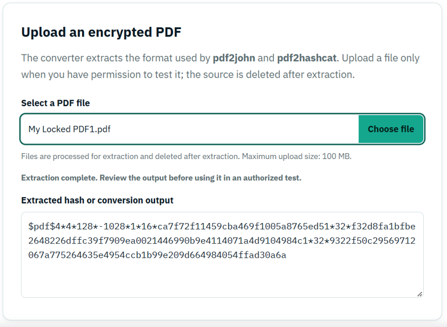
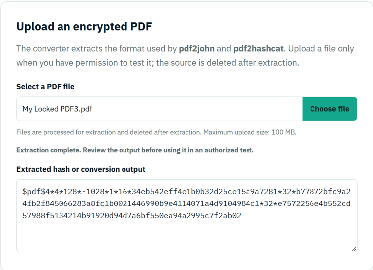
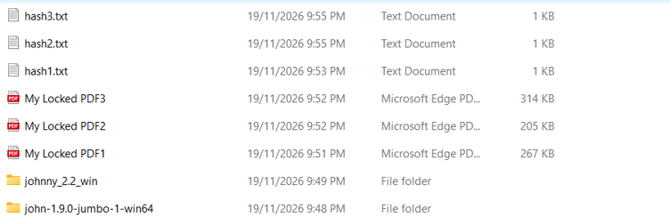
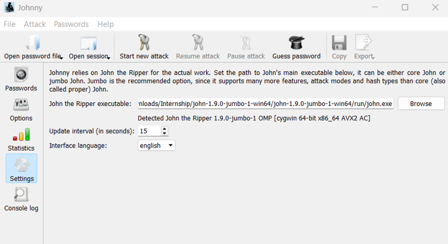
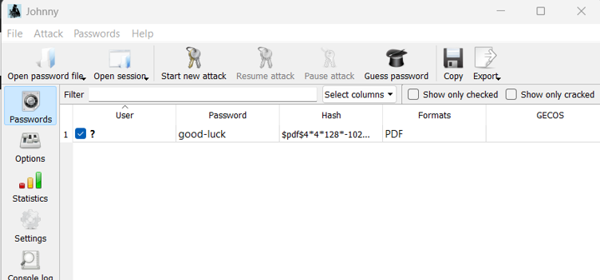
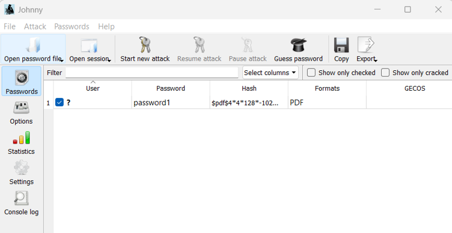
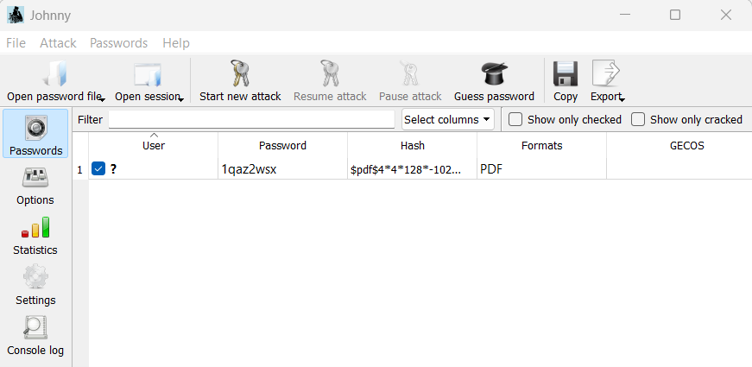
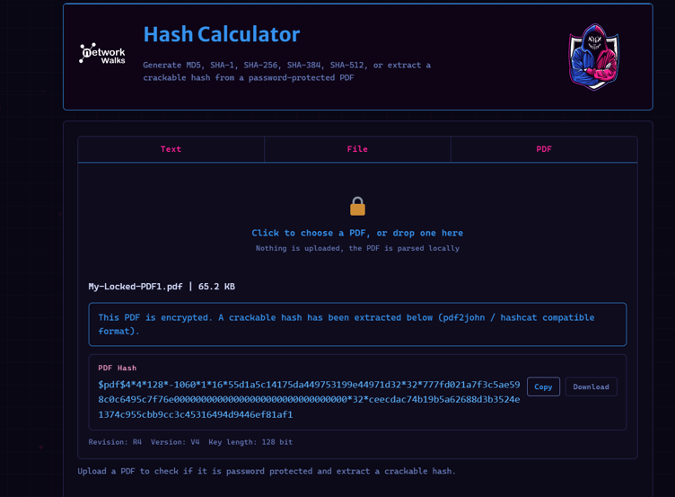
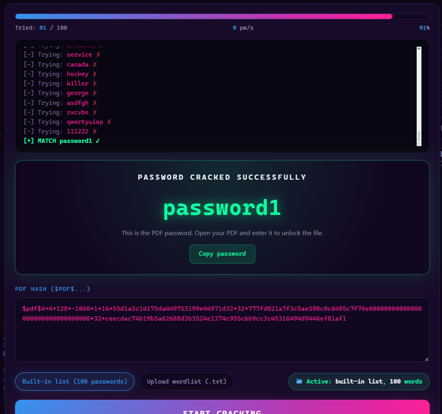

# NETWORKWALKS-B084-WEEK3-PM1-2

### Week 3 | Password Auditing and Encrypted PDF Password Recovery

**NetworkWalks Cybersecurity Internship Program | Batch B084**

Practical password auditing using John the Ripper, Johnny GUI, PDF hash extraction and dictionary-based password recovery.

---

## Project Overview

This project involved practical password auditing and recovery exercises as part of the **NetworkWalks Cybersecurity Internship Program (B084)**. The activities focused on examining the security of password-protected PDF documents and understanding how weak or predictable passwords can be identified through dictionary-based password attacks.

The project was divided into two modules. **Project Module 1 (PM1)** involved extracting password hashes from three encrypted PDF documents, configuring John the Ripper through Johnny GUI and performing password recovery using wordlists. **Project Module 2 (PM2)** involved using NetworkWalks' online PDF password recovery tool to extract password verification data and conduct password recovery through its browser-based interface.

Both modules provided practical experience with password hash extraction, password auditing tools and dictionary-based recovery techniques.

## Objectives

- Extract password hashes from encrypted PDF documents.
- Configure John the Ripper Jumbo through Johnny GUI.
- Understand how PDF password verification data is processed.
- Perform dictionary-based password recovery using wordlists.
- Use NetworkWalks' online PDF password recovery tool.
- Evaluate the effectiveness of common password-guessing techniques.
- Understand the security implications of weak and predictable passwords.

## Tools and Technologies

| Tool / Technology | Purpose |
|---|---|
| Windows 10 Virtual Machine | Environment used to perform the exercises |
| John the Ripper Jumbo | Password auditing and recovery |
| Johnny GUI | Graphical interface for managing John the Ripper |
| PDF Hash Extraction Tools | Extracting password hashes from encrypted PDF documents |
| Password Wordlists | Supplying candidate passwords for dictionary attacks |
| NetworkWalks Online Password Recovery Tool | Browser-based PDF hash extraction and password recovery |

---

# Project Module 1 (PM1) | John the Ripper

## 1. PDF Hash Extraction

The first stage involved extracting password verification data from three password-protected PDF documents.

Encrypted PDF documents do not directly expose their original passwords. Instead, password verification data is stored within the document's security structure. Password auditing tools can extract this information into a hash format that can subsequently be tested against candidate passwords.

A PDF hash extraction tool was used to process each of the three documents. The extracted hashes were saved individually as `Hashfile1.txt`, `Hashfile2.txt` and `Hashfile3.txt` for use with John the Ripper.

*Extracted password hash from the first encrypted PDF document.*

*Extracted password hash from the second encrypted PDF document.*

*Extracted password hash from the third encrypted PDF document.*

*Directory containing the encrypted PDF documents, extracted hash files and associated tools.*

## 2. John the Ripper Configuration

After extracting the PDF hashes, I configured **Johnny GUI** to use the John the Ripper executable located within the downloaded John the Ripper Jumbo directory.

Johnny provides a graphical interface for John the Ripper, allowing password hashes to be loaded and password recovery sessions to be managed without relying exclusively on command-line interaction.

During configuration, Johnny successfully detected the installed John the Ripper version:

`1.9.0-jumbo-1`

This confirmed that the graphical interface was correctly connected to the John the Ripper executable and ready to process the extracted PDF hashes.

*Johnny GUI configured with the John the Ripper Jumbo executable.*

## 3. Dictionary-Based Password Recovery

With the configuration completed, the three extracted PDF hashes were loaded into Johnny GUI for password recovery.

A dictionary-based attack was performed using candidate passwords supplied through a wordlist. John the Ripper tested these candidates against the extracted password hashes to determine whether any of the supplied passwords matched the original document passwords.

All three PDF passwords were successfully recovered.

### Password Recovery Results

| PDF Document | Recovered Password |
|---|---|
| PDF 1 | `good-luck` |
| PDF 2 | `password1` |
| PDF 3 | `1qaz2wsx` |

*Successful recovery of the first PDF password, `good-luck`.*

*Successful recovery of the second PDF password, `password1`.*

*Successful recovery of the third PDF password, `1qaz2wsx`.*

The successful recovery of all three passwords demonstrated how dictionary-based attacks can identify weak or predictable passwords when the correct password is included in the candidate wordlist.

---

# Project Module 2 (PM2) | NetworkWalks Online Password Recovery Tool

## 4. Online PDF Hash Extraction

The second project module involved using NetworkWalks' online PDF password recovery tool to extract password verification data from an encrypted PDF document.

Unlike the first module, which used a locally configured extraction tool, this exercise used a browser-based interface to process the PDF document.

The encrypted PDF was uploaded to the online tool, which extracted and displayed its password verification data. The resulting hash could then be used by the password recovery functionality provided through the platform.

*NetworkWalks online tool extracting password verification data from an encrypted PDF document.*

## 5. Online Password Recovery

After extracting the PDF password hash, I used the online password recovery interface to perform a dictionary-based attack.

The interface provided a built-in wordlist containing 100 candidate passwords, alongside an option to upload a custom wordlist for additional testing.

During the exercise, the tool successfully identified the password:

`password1`

This demonstrated how a relatively small collection of common password candidates can be sufficient to recover a document password when it relies on a predictable or frequently used combination.

*Successful recovery of the PDF password, `password1`, using the NetworkWalks online recovery tool.*

## 6. Completion Flag Capture

Following the password recovery exercises, NetworkWalks provided completion flags as evidence of successful task completion.

The flags were captured and retained as part of the project documentation to demonstrate completion of the assigned activities across the two project modules.

*First NetworkWalks password recovery completion flag.*

*Second NetworkWalks password recovery completion flag.*

*Third NetworkWalks password recovery completion flag.*

*Final NetworkWalks password recovery completion flag.*

---

# Results and Lessons Learned

## 7. Project Results

Both project modules were completed successfully, providing practical experience with local and browser-based PDF password auditing techniques.

### PM1 | John the Ripper

- Extracted password hashes from three encrypted PDF documents.
- Saved the extracted hashes into individual text files.
- Configured Johnny GUI to use the John the Ripper Jumbo executable.
- Verified the installation through version detection.
- Performed dictionary-based password recovery.
- Successfully recovered all three PDF passwords.

### PM2 | NetworkWalks Online Tool

- Uploaded an encrypted PDF document to the online recovery tool.
- Extracted its password verification data through the browser interface.
- Used the built-in wordlist containing 100 candidate passwords.
- Successfully recovered the password `password1`.
- Captured the four completion flags as supporting evidence.

### Overall Outcome

The exercises demonstrated that password-protected documents can remain vulnerable when their passwords are weak, common or predictable. They also highlighted how password auditing tools can be used to evaluate password strength by testing candidate passwords against extracted verification data.

## 8. Lessons Learned

These activities strengthened my practical understanding of password security, hash extraction and password recovery techniques.

Key lessons included:

- **PDF hash extraction:** Learned how password verification data can be extracted from encrypted PDF documents and prepared for password auditing.
- **John the Ripper configuration:** Gained experience configuring John the Ripper Jumbo through Johnny GUI and verifying the connection between the graphical interface and executable.
- **Dictionary-based attacks:** Developed an understanding of how wordlists are used to test candidate passwords against extracted hashes.
- **Password predictability:** Observed how common passwords and predictable character combinations can be recovered through relatively straightforward password-guessing techniques.
- **Online password auditing:** Gained practical experience using a browser-based password recovery platform and its built-in candidate wordlist.
- **Password security:** Recognised the importance of using strong, unique and unpredictable passwords to protect sensitive documents.

## 9. Conclusion

Week 3 provided practical experience in password auditing and the recovery of encrypted PDF documents through two different approaches.

Using John the Ripper and Johnny GUI, I extracted password hashes from three encrypted PDF files and successfully recovered all three passwords through dictionary-based attacks. I then used NetworkWalks' online password recovery tool to extract and test PDF password verification data, successfully recovering another password and capturing the associated completion flags.

These exercises demonstrated the relationship between password complexity and resistance to dictionary-based attacks. They also strengthened my understanding of how password auditing tools can be applied to assess the security of protected documents.

All activities were conducted using authorised training materials as part of the NetworkWalks Cybersecurity Internship Program (B084).

---

## Responsible and Ethical Use

Password auditing and recovery tools can be used for legitimate security assessments, but they must only be applied to documents and systems for which permission has been granted.

The activities documented in this project were performed using authorised training materials provided as part of the NetworkWalks Cybersecurity Internship Program. The techniques demonstrated are intended for educational purposes and for understanding password security weaknesses.

## Resources

- [John the Ripper password cracker - Official Download Page](https://www.openwall.com/john/)
- [Johnny - GUI for John the Ripper - Official Download Page](https://openwall.info/wiki/john/johnny)
- [Extract a PDF hash for a controlled test - Website](https://www.onlinehashcrack.com/tools-pdf-hash-extractor.php)
- [Networkwalks Password Cracker - Website](https://networkwalks.com/password-cracker/)

## Author Information

**Joshua Kwon**  
Cybersecurity Intern | NetworkWalks B084

**LinkedIn:** [Joshua Kwon](https://www.linkedin.com/in/joshua-kwon-05914337a/)

## Project Information

| Category | Details |
|---|---|
| Program | NetworkWalks Cybersecurity Internship Program |
| Batch | B084 |
| Week | Week 3 |
| Project Modules | PM1 & PM2 |
| PM1 | John the Ripper and Johnny GUI |
| PM2 | NetworkWalks Online Password Recovery Tool |
| Project Reference | `NETWORKWALKS-B084-WEEK3-PM1-2` |
| Primary Focus | Password Auditing and Encrypted PDF Recovery |

---

